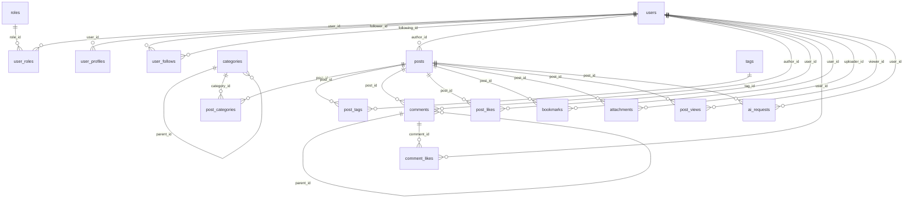
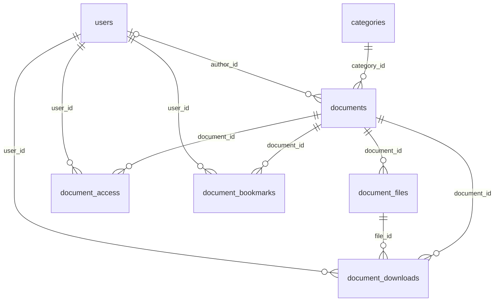

# Knowledge Hub database

MySQL 8.0.16+; 24 application tables plus Flyway history. No Docker required.

## Tables

| Table | JPA entity | Fields (in addition to id, created_at, updated_at, version) |
|---|---|---|
| roles | Role | name, description |
| users | User | username, email, passwordHash, status, emailVerified, lastLoginAt, authVersion |
| user_roles | UserRole | user, role |
| user_profiles | UserProfile | user, displayName, bio, avatarUrl, websiteUrl, location, institution, faculty |
| user_follows | UserFollow | follower, following |
| categories | Category | name, slug, description, parent, sortOrder, active |
| tags | Tag | name, slug, description |
| posts | Post | author, title, slug, summary, content, status, visibility, publishedAt, institution, faculty |
| post_categories | PostCategory | post, category |
| post_tags | PostTag | post, tag |
| comments | Comment | post, author, parent, content, status, editedAt |
| post_likes | PostLike | post, user |
| comment_likes | CommentLike | comment, user |
| bookmarks | Bookmark | user, post |
| attachments | Attachment | uploader, post, originalName, storageKey, contentType, sizeBytes, status |
| post_views | PostView | post, viewer, visitorHash, viewedAt |
| ai_requests | AiRequest | user, post, operation, provider, model, status, inputTokens, outputTokens, latencyMs, errorCode, completedAt |

## Relationships

## Data rules

- All foreign keys restrict deletion. Use explicit lifecycle services and soft status transitions; do not physically delete an account with dependent records.
- Comment replies must belong to the same post. Cycles deeper than one level in categories/comments require service validation.
- Composite unique constraints prevent duplicate likes, follows, bookmarks, role grants and tag/category links.
- Account passwords are BCrypt hashes. Authentication uses stateless JWT Bearer tokens; there are no refresh/reset/verification token tables.
- Dates use UTC. JPA owns timestamps and optimistic-lock versions. Direct SQL inserts must provide timestamps.
- View visitor and IP hashes must be keyed pseudonyms; do not store raw IP addresses.
- AI request metadata excludes prompt/output text; token counts and timing are nonnegative.
- Status/type values are constrained in MySQL. Services must enforce transitions, ownership, role authorization and transactional updates.
- Seed data defines ADMIN/MODERATOR/USER roles. Migrations do not seed accounts or passwords. Account APIs and role checks are implemented; the optional dev bootstrap creates the first admin.

## Apply

Run `./mvnw.cmd spring-boot:run` from backend (Windows: `.\mvnw.cmd spring-boot:run`). Flyway applies V1/V2/V3/V4/V5/V6/V7/V8/V9 and Hibernate validates entity mappings. Never edit a migration after application; add V10+ instead.
H2 tests verify startup and account/security flows; run the opt-in MySQL integration test for actual schema constraints.

Authorization uses users -> user_roles -> roles. Detailed permission tables were removed by V3; V1/V2 remain unchanged as migration history.

## Hỗ trợ tiếng Việt / Unicode
- MySQL dùng VARCHAR/TEXT/LONGTEXT với CHARACTER SET utf8mb4 COLLATE utf8mb4_unicode_ci. Không cần NVARCHAR: MySQL diễn giải NVARCHAR thành bộ mã utf8mb3 đã lỗi thời.
- File docs/database/knowledge_hub.sql ghi rõ charset cho từng cột văn bản và có thể dùng làm minh chứng.
- Entity JPA dùng Java String (Unicode); không thêm @Nationalized vì cần giữ kiểu VARCHAR/TEXT phù hợp MySQL.
- JDBC dùng characterEncoding=UTF-8 và connectionCollation=utf8mb4_unicode_ci trong các profile MySQL. Maven đọc mã nguồn bằng UTF-8.
- V1–V3 được giữ nguyên lịch sử/checksum; V4 đặt mặc định database thành utf8mb4. Các bảng từ V1 vốn đã dùng utf8mb4.
- Kiểm thử MySQL xác nhận charset các cột và kết nối; lưu/đọc tiếng Việt có dấu và emoji qua JPA, VARCHAR, TEXT, LONGTEXT.
- Nguồn: https://dev.mysql.com/doc/refman/8.4/en/charset-national.html
## Account implementation
users.auth_version was added by V5 to revoke JWTs after account changes. Authentication and admin account APIs are implemented; see ../accounts.md. Role names are ADMIN, MODERATOR, USER.

## Document library (V6/V7)
| Table | JPA entity | Purpose |
|---|---|---|
| documents | Document | Metadata, category/author, FREE/PAID, decimal price, publishing status |
| document_files | DocumentFile | Private storage key, filename, type and byte size |
| document_access | DocumentAccess | Manual/purchase entitlement with expiry and revocation |
| document_downloads | DocumentDownload | Per-user history and title/filename snapshots |
| document_bookmarks | DocumentBookmark | Unique saved document per user |

V7 seeds four categories and seven original starter documents. See ../library.md for download/access rules and API coverage.

## Scope reduction (V8)
V8 removes eleven optional tables and their JPA entities/repositories. Account/JWT authentication, document bookmarks, access grants, downloads and AI request metadata are retained. Migration V1 remains immutable so existing Flyway checksums stay valid. The standalone knowledge_hub.sql represents only the final schema (now 24 tables after V9).

## Organization hierarchy (V9)
| Table | Entity | Main fields |
|---|---|---|
| institutions | Institution | id, name, type (UNIVERSITY/COMPANY/OTHER) |
| faculties | Faculty | id, institution_id, name |

user_profiles, documents and posts now have nullable institution_id/faculty_id. A composite foreign key validates the faculty/institution pair, and CHECK forbids a faculty without an institution. Application validation forbids faculty selection for OTHER. See ../organizations.md for ERD, API, upload and ranking behavior.
