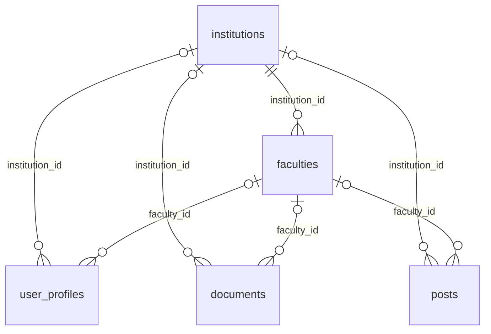

# Trường / Tổ chức và Khoa / Chuyên ngành

## Dữ liệu
Migration V9 thêm institutions và faculties, đưa tổng số bảng nghiệp vụ lên 24.
- institutions: id BIGINT, name VARCHAR(255) Unicode, type UNIVERSITY / COMPANY / OTHER; cùng created_at, updated_at, version dùng chung.
- faculties: id BIGINT, institution_id bắt buộc, name VARCHAR(255) Unicode. Tên khoa là duy nhất trong mỗi tổ chức.
- user_profiles, documents và posts: institution_id và faculty_id đều nullable.
- Khóa ngoại kép (faculty_id, institution_id) tham chiếu faculties(id, institution_id); CHECK yêu cầu có institution_id khi có faculty_id.
- API từ chối khoa không thuộc tổ chức, khoa không có trường và faculty_id khi chọn tổ chức OTHER.
- V9 cung cấp danh mục mẫu theo yêu cầu: Đại học Bách Khoa Hà Nội, Đại học FPT và Khác; hai khoa mẫu CNTT/Kinh tế cho mỗi trường. Đây là dữ liệu khởi đầu, có thể điều chỉnh bằng migration tiếp theo.



## API
| Method | Endpoint | Chức năng |
|---|---|---|
| GET | /api/institutions | Danh mục tổ chức công khai |
| GET | /api/institutions/{id}/faculties | Khoa thuộc tổ chức; OTHER trả mảng rỗng |
| POST | /api/auth/register | Thêm institutionId, facultyId tùy chọn; kiểm tra trước khi tạo tài khoản |
| GET | /api/users/me | Có organization: institutionId/name/type, facultyId/name |
| PUT | /api/users/me/profile | Cập nhật trường/khoa của chính mình; cần JWT Bearer |
| GET | /api/documents?institutionId=1&facultyId=2 | Lọc đúng trường/khoa; hỗ trợ q, category, access, page, size |
| GET | /api/documents?global=true | Xem toàn bộ, không áp dụng trường từ profile |
| GET | /api/documents?institutionId=1&sort=popular | Xếp theo lượt tải 7 ngày gần nhất, sau khi lọc |
| GET | /api/categories | Danh mục chủ đề đang hoạt động cho form upload |
| POST | /api/documents | Multipart gồm metadata (JSON) và file; cần JWT Bearer |

Nếu không truyền institutionId và không bật global=true, backend lấy trường từ profile người đăng nhập. Profile chưa chọn trường hoặc có type OTHER sẽ xem toàn bộ. facultyId chỉ áp dụng khi có trường phù hợp. global=true không kết hợp institutionId/facultyId cụ thể.

Lọc tổ chức là công cụ khám phá, không phải rào cản truy cập riêng tư theo trường. Tài liệu đã công bố vẫn xem công khai; quyền tải phụ thuộc đăng nhập và FREE/PAID/access grant.

## Giao diện
- Đăng ký: chọn trường rồi mới chọn khoa. Đổi trường xóa lựa chọn khoa cũ; chọn Khác ẩn khoa.
- Tài khoản của tôi: cập nhật trường/khoa mà không phải đăng xuất.
- Thư viện: mặc định trường từ profile, có lựa chọn toàn bộ, chọn khoa và sắp xếp “Tải nhiều 7 ngày”.
- Đóng góp (#upload): tự điền trường/khoa từ profile; backend gắn theo profile, thành viên cần sửa hồ sơ nếu muốn đổi; ADMIN được chọn tổ chức khi thêm giáo trình chuẩn.
- Chi tiết và thẻ tài liệu hiển thị nhãn trường/khoa và đúng định dạng file.
- Posts có trường dữ liệu tổ chức; feed đọc bài đã xuất bản từ người đang theo dõi đã có từ Sprint 1.

## Upload và lưu trữ
Form hỗ trợ PDF, PPT/PPTX, DOCX, Markdown, TXT tối đa 20 MB. File được lưu riêng tư tại backend/config/document-storage, được Git bỏ qua; có thể cấu hình app.documents.storage-dir (biến môi trường APP_DOCUMENTS_STORAGE_DIR).

Backend xác thực metadata, tổ hợp trường/khoa, giá FREE=0 / PAID>0 và định dạng tệp; PDF kiểm tra signature, DOCX kiểm tra cấu trúc ZIP/Word cùng giới hạn giải nén, file văn bản cần UTF-8. Tên lưu vật lý dùng UUID, không dùng đường dẫn do client cung cấp. File được dọn nếu transaction thất bại. Download vẫn qua endpoint kiểm tra quyền, không có URL static trực tiếp.

Tài liệu của thành viên vào PENDING sau upload; ADMIN duyệt hoặc từ chối, tác giả chỉnh sửa sẽ gửi duyệt lại. ADMIN thêm giáo trình chuẩn được công bố trực tiếp. Xem library.md. Thanh toán trực tuyến chưa triển khai; tài liệu có phí cần access grant, còn tác giả có thể tải tài liệu của mình.

Ví dụ metadata cho multipart:
```json
{
  "title": "Đề ôn tập Java cuối kỳ",
  "summary": "Câu hỏi và bài tập ôn tập",
  "description": "Thông tin chi tiết",
  "categoryId": 1,
  "level": "BEGINNER",
  "accessType": "FREE",
  "price": 0,
  "institutionId": 1,
  "facultyId": 1
}
```
Các ID là ví dụ; hãy dùng ID thực từ API danh mục.

## Ranking và AI
sort=popular đếm document_downloads.created_at trong 7 ngày UTC gần nhất, chỉ trên các tài liệu đã qua bộ lọc trường/khoa. Cách này là baseline dựa trên hành vi, chưa phải mô hình học máy. Profile và sự kiện tải là dữ liệu đầu vào có sẵn để tích hợp mô hình AI sau đó.

## Kiểm tra
Kiểm thử backend bao gồm đăng ký sai tổ hợp không tạo tài khoản, profile OTHER, mặc định trường/global/faculty, ranking không tính lượt tải cũ, upload/tải file thật và chặn sai định dạng. MySQL kiểm tra khóa ngoại kép trực tiếp trên profile/document/post. Playwright chạy luồng đăng ký → upload tự điền → tải → lọc/ranking → đổi Khác → mobile.
## Admin CRUD Sprint 1

Chọn Quản trị → Trường / Khoa (#admin/organizations). ADMIN được thêm/sửa/xóa trường/tổ chức, chọn trường để thêm/sửa/xóa khoa; có xác nhận xóa và thông báo lỗi khi đang được dùng.

API ADMIN: GET/POST /api/admin/institutions; PUT/DELETE /api/admin/institutions/{id}; GET /api/admin/institutions/{id}/faculties; POST /api/admin/faculties; PUT/DELETE /api/admin/faculties/{id}.

Institution JSON: name, type (UNIVERSITY/COMPANY/OTHER). Faculty JSON: institutionId, name. Tên không rỗng, tối đa 255; trường không trùng tên, khoa không trùng trong cùng trường. Không thêm khoa dưới OTHER; giữ ít nhất một OTHER; không đổi sang OTHER khi còn khoa. Chặn xóa trường còn khoa hoặc hồ sơ/tài liệu/bài viết tham chiếu; chặn xóa/chuyển khoa đang dùng. Trả 409 nếu xung đột; 403 nếu không ADMIN, 401 nếu thiếu JWT. Foreign key MySQL bảo vệ dữ liệu đồng thời.
